# ppt-fusion-skill 🎨⚡

> **融合型智能幻灯片生成 Skill**：深度融合 **ppt-master** 的工程决策链与结构纪律 × **taste-skill** 的顶级美学法庭与反模板准则，并搭载独创的 **首席视觉质检总监（Chief Visual QA Director）** 终检评测闭环。

[](LICENSE)
[](SKILL.md)
[](install.sh)
[](#输出规格)

---

## 📖 项目背景与融合渊源

当前大模型生成 PPT 普遍面临两大痛点：
1. **空有格式无灵魂**：生成的 PPT 充斥着典型 AI 模板病——三等分小卡片、1px 细边框、无意义渐变球、廉价感 Emoji、假 Dashboard，严重缺乏定制审美与视觉品味；
2. **逻辑断层且缺乏把控**：缺乏严谨的工程闭环，内容常常自说自话、随意编造数据、排版出现重叠越界，甚至在交付前没有真正“看过”自己生成的幻灯片。

**`ppt-fusion-skill`** 专为解决上述问题而诞生。它将开源社区中极具影响力的两大 PPT Skill 体系深度杂交融合：

```
                ┌──────────────────────────────────────────────┐
                │             ppt-fusion-skill                 │
                └──────────────────────┬───────────────────────┘
                                       │
            ┌──────────────────────────┴──────────────────────────┐
            ▼                                                     ▼
┌──────────────────────────────┐              ┌──────────────────────────────┐
│       ppt-master 基因        │              │       taste-skill 基因       │
├──────────────────────────────┤              ├──────────────────────────────┤
│ • 严谨分阶段工程决策链       │              │ • 审美法庭与反模板清单       │
│ • 5 大 Mode 论证骨架体系     │              │ • "先有想法再落笔"理念       │
│ • 阻塞门控机制（⛔ BLOCKING） │  融合赋能    │ • Q0 主体专有资产盘点        │
│ • 机器门禁（H1-H7 硬规则）   │ ───────────► │ • 六角色调色板 + 中性层推导  │
│ • token 驱动的可编辑 PPTX 底座│              │ • 14-pass 人工视觉走查法     │
│ • 修在拥有层，事实零捏造     │              │ • 页面呼吸节奏与大反差字号   │
└──────────────────────────────┘              └──────────────────────────────┘
                                       │
                                       ▼
            ┌─────────────────────────────────────────────────────┐
            │       🌟 独创核心：首席视觉质检总监终检循环          │
            │  144 DPI 逐页截屏 → 7 维像素级打分 → 9.0 门禁循环修复  │
            └─────────────────────────────────────────────────────┘
```

- **继承 ppt-master 的工程纪律**：分阶段推进、阻塞门控、修在拥有层、严禁静默降级、无幻觉数据策略、自动化 PPTX 构建底座；
- **注入 taste-skill 的顶级审美**：坚决剔除模板痕迹、从主体专有资产中提炼视觉隐喻、建立严格的六角色调色板规范、实施 14-pass 视觉走查；
- **进化出专属终检机制**：引入极度挑剔的“首席视觉质检总监”，用多模态真截屏驱动自动化循环打磨，达不到 9.0 分绝不交付。

---

## 🌟 核心创新点与亮点

### 1. 独创「首席视觉质检总监」（Chief Visual QA Director）多模态终检循环
传统 AI PPT 工具生成代码后直接打包，从不检验渲染实际效果。本 Skill 在交付前设立了不可逾越的最终把关节点：
- **角色彻底切换**：生成完成后，Agent 角色强制从“搭建者”切换为“由顶尖演示设计师、信息图表专家与 4A 创意总监融合而成的总监”，以极度挑剔的眼光审视成果。
- **真截屏像素级视检**：使用 LibreOffice 将 PPTX 渲染为 144 DPI 高清 PNG 截屏，通过多模态 Vision 模型逐页审视（只看真实截屏，不看代码，避免读入编写意图）。
- **7 维严苛打分矩阵**：
  - `D1` 内容与文字精准度（错别字与语病零容忍）
  - `D2` 独立视觉骨架（**零容忍项：枯燥纯文本列表页、与上一页完全同骨架页，该维直接打 0 分并强制推倒重做！**）
  - `D3` 风格契合度（严守品牌色与风格卡定义）
  - `D4` 视觉焦点与重点（一页有且仅有一个视觉主物）
  - `D5` 色彩与可读性（正文对比度严格 ≥ 4.5:1，大字 ≥ 3:1）
  - `D6` 排版与空间（杜绝任何重叠、出界、失衡）
  - `D7` 逻辑流与连贯性（全 deck 视觉装置与故事线贯穿）
- **Condition / Loop 闭环修复**：整体平均分 `< 9.0` 即刻打回，输出《质检打回修改指令单》回退重构，最多循环 3 轮（设熔断保护），`≥ 9.0` 方可签署《首席品鉴验收报告》放行交付。

### 2. Q0 主体专有盘点（Inventory）与连续性视觉装置（Motif Engine）
- **告别通用词搜图**：在 P1 脑爆阶段，强制盘点 8–12 件“只属于该主题、换竞品名不成立”的专有资产（专有物料、门牌街景、特色数据、仪式时刻、约束条件）。
- **一句话想法落页**：提炼 `【属于这个主题的独特东西】成为【全 deck 重复出现的视觉装置】`。
- **连续性工程**：视觉装置并非孤立出现，而在全篇中以 `scale / crop / density / position` 等变体节奏连续演进，并提供跨页平滑 Morph 命名候选。

### 3. 论证骨架（Mode）与视觉风格（Style）正交解耦体系
- **Mode 决定“怎么论证”，Style 决定“长什么样”**，两者完全解耦正交：
  - `narrative`（弧光推进：路演 / 融资 / 品牌故事）
  - `pyramid`（结论先行：投决 / 汇报 / 管理层决策）
  - `instructional`（平行教学：培训 / 教程 / Onboarding）
  - `showcase`（视觉主导：发布会 / 品牌宣传）
  - `briefing`（中性覆盖：日常例会 / 手册 / 目录）
- 每页大纲标准化包含五栏：`claim`（断言）/ `proof`（证据）/ `move`（观众心理位移）/ `关系`（拓扑结构）/ `内容`（上屏高亮）。

### 4. 专业级六角色调色板 + 中性层派生 + 严禁 AI 脏色
- 严格锁定调色板六角色：`bg`（背景）、`surface`（卡片表面）、`ink`（正文字色）、`muted`（次要文字）、`accent`（行动高亮，单屏面积 <5% 且 ≤2 处）、`accent_ink`（高亮场文字）。
- 按风格卡自动推导中性层（分层板网格、压图遮罩 `scrim`、阴影层）。
- 严查图文字对比度，图上字强制配备定向透明度梯度遮罩（Scrim），杜绝“白底白字、背景花乱看不清”的劣质排版。

### 5. 零幻觉数据规范与“修在拥有层”原则
- **事实零捏造**：没有现成数据就显式留空 `[待用户提供]`，严禁大模型擅自编造客户引言、营收数据或假 Logo 墙。
- **修在拥有层**：单页问题修单页，大纲问题回大纲，母版问题改母版，绝不通过表面打补丁或静默降级掩盖底层缺陷。

### 6. 双轨交付：原生可编辑 PPTX + 矢量印刷级 PDF
- 底座基于 Python 精密排版引擎，产出的 `.pptx` 具备完整的母版结构、原生矢量形状与内嵌图表工作簿，用户可在 PowerPoint / Keynote 中二次编辑；
- 同时通过无损管线直接导出高保真 `.pdf`，开箱即用。

---

## 🔄 全流程架构图（六阶段一条链 + 终检循环）

```mermaid
flowchart TD
    Start(["🚀 用户发起需求 (/ppt-fusion-skill)"]) --> P1

    subgraph P1["P1 脑爆对齐 (13 项清单) ⛔ BLOCKING"]
        P1_A["行业/受众/场景/风格/页数/输出格式"]
        P1_B["Q0 主体盘点 (专有 inventory 提取)"]
        P1_C["阅读模式推导 (presentation / balanced / text)"]
        P1_D["论证骨 Mode 决议 (narrative/pyramid 等)"]
        P1_E["生成唯一事实源 brief.json"]
        P1_A --> P1_B --> P1_C --> P1_D --> P1_E
    end

    P1 -->|用户确认开工| P2

    subgraph P2["P2 设计定稿 ⛔ BLOCKING"]
        P2_A["P2.1 找想法: 专有装置连续性工程设计"]
        P2_B["P2.2 发三方向: 选定风格卡 (锁定 direction.json)"]
        P2_C["P2.3 定色锁定: 六角色 + 中性层推导 (palette.py)"]
        P2_D["P2.4 五栏大纲构建: claim/proof/move/关系/内容"]
        P2_E["lint_outline.py 文本门禁检测"]
        P2_A --> P2_B --> P2_C --> P2_D --> P2_E
    end

    P2 -->|用户批准大纲与方向| P3

    subgraph P3["P3 逐页设计与搭建 (Do)"]
        P3_A["P3.1 读页定计 (构图/色彩/配图/关系→topo 四行)"]
        P3_B["P3.2 配图链路: 本地图 ➔ 专有词联网 ➔ 矢量 SVG 现画"]
        P3_C["P3.3 构建器 v2 渲染 (全 token 驱动，生成 deck-v1.pptx)"]
        P3_D["P3.4 每 3-5 页看图迭代修整"]
        P3_A --> P3_B --> P3_C --> P3_D
    end

    P3 --> P4

    subgraph P4["P4 交付前自检 (Check & Critique) ⛔ BLOCKING"]
        P4_A["机器门: selfcheck.py (H1-H7 硬规则+S1-S6+R级回执)"]
        P4_B["人工门: 14-pass 视觉走查 (一秒/眯眼/遮标/左缘/字色图)"]
        P4_C["加权总分打分与修复 (≤3轮)"]
        P4_A --> P4_B --> P4_C
    end

    P4 -->|自检合格| P4_Final

    subgraph P4_Final["🌟 P4-final 首席视觉质检总监 (Condition / Loop) ⛔ BLOCKING"]
        QA_Step1["Step 1: 144 DPI 逐页高清截屏 (qa_director.py)"]
        QA_Step2["Step 2: 7 维度像素级打分 (D1~D7，同骨架直接判 0 分)"]
        QA_Verdict{"Step 3: 平均分判定"}
        QA_Rework["打回修改: 出具【质检打回修改指令单】\n回退 P3 拥有层重做 (轮次+1)"]
        QA_Pass["品鉴通过: 出具【首席品鉴验收报告】"]
        QA_Fuse["熔断说明: 达 3 轮仍未满 9 分\n出具《质检遗憾说明》"]

        QA_Step1 --> QA_Step2 --> QA_Verdict
        QA_Verdict -- "< 9.0 分 (轮次 ≤ 3)" --> QA_Rework
        QA_Rework --> P3
        QA_Verdict -- "≥ 9.0 分" --> QA_Pass
        QA_Verdict -- "轮次 > 3 仍 < 9.0" --> QA_Fuse
    end

    QA_Pass --> P5
    QA_Fuse --> P5

    subgraph P5["P5 导出与交付 (Act)"]
        P5_A["可编辑 PPTX 交付"]
        P5_B["LibreOffice 无损转换 PDF"]
        P5_C["随附设计说明十项 + 验收报告"]
        P5_A --> P5_B --> P5_C
    end

    P5 --> End(["🎉 完美交付"])
```



---

## 📂 项目结构

```text
ppt-fusion-skill/
├── SKILL.md                          # Skill 核心行为准则与完整执行流说明
├── README.md                         # 项目主页与架构介绍文档
├── install.sh                        # 跨平台一键安装脚本 (支持 universal/各平台)
├── assets/
│   ├── brief-template.json           # 13 问完整 brief 需求模板
│   ├── outline-template.md           # 五栏结构化大纲模板
│   └── palettes.json                 # 12 套精心设计的开箱即用调色板
├── references/
│   ├── briefing-questions.md         # P1 需求对齐 13 项提问库与选项话术
│   ├── design-taste-for-slides.md    # P2-P3 幻灯片设计美学与反模板禁令
│   ├── style-cards.md                # 7 张先导风格卡 (名碑/句版/色章/纯字等)
│   ├── page-design-playbook.md       # P3 逐页设计定计手册 (构图/色彩/配图/拓扑)
│   ├── workflow.md                   # 全流程阶段门控、角色与失败回退指引
│   ├── selfcheck-rubric.md           # P4 机器检查与 14-pass 人工走查细则
│   ├── qa-director.md                # P4-final 首席质检总监 7 维评审标准与报告模版
│   └── output-formats.md             # P5 导出规格与设计说明书规范
└── scripts/
    ├── brief_wizard.py               # P1 需求采集与 brief.json 管理器
    ├── deal_directions.py            # P2 三方向生成与抽取器
    ├── palette.py                    # 调色板六角色与中性层计算引擎
    ├── outline_builder.py            # 五栏结构化大纲生成器
    ├── lint_outline.py               # 大纲文本门禁自动化检测器
    ├── fetch_images.py               # 专有 Inventory 关键词配图工具
    ├── make_svg_art.py               # 视觉装置矢量 SVG 实时生成器
    ├── build_deck.py                 # token 驱动的原生 PPTX 组装构建器
    ├── selfcheck.py                  # P4 机器门禁检查脚本 (溢出/重叠/对比度等)
    ├── qa_director.py                # P4-final 截屏渲染与质检评分循环控制器
    └── prepare_assets.py             # 资源登记与规范化预处理器
```

---

## 🚀 安装指南

本 Skill 自带跨平台 POSIX 安装脚本，支持在当前环境或主流 AI Agent 平台中一键部署：

### 1. 自动检测平台安装
```bash
chmod +x ./install.sh
./install.sh
```

### 2. 指定通用路径或目标环境
```bash
# 安装到当前用户通用 Skills 目录
./install.sh --platform universal

# 同时分发到所有已识别的 Agent 平台 (Antigravity / Claude Code / Cursor / OpenClaw 等)
./install.sh --all
```

### 3. 环境依赖
- **Python**: `>= 3.10`
- **核心 Python 库**:
  ```bash
  pip install python-pptx pillow
  ```
- **导出与渲染工具 (可选但推荐，用于 PDF 转换与 P4-final 高清截屏)**:
  - macOS: `brew install libreoffice`
  - Linux (Ubuntu/Debian): `sudo apt-get install libreoffice`

---

## 💡 使用示例

在你的 AI Agent 环境中键入激活命令即可开启融合创作流程：

### 示例 1：全套融资路演 PPT
```text
/ppt-fusion-skill 帮我做一份面向一线 VC 的 AI 基础设施融资商业计划书，约 15 页，要求深色科技风，输出 PPTX 和 PDF。
```

### 示例 2：基于现有文档重塑
```text
/ppt-fusion-skill 根据这份产品白皮书制作 10 页高管汇报幻灯片，使用金字塔结论先行模式（pyramid），风格要求优雅克制。
```

### 示例 3：现有 PPTX 极致美化重构
```text
/ppt-fusion-skill 美化优化当前工程里的 input.pptx，彻底消除 AI 模板痕迹，通过首席视觉质检总监的 9.0 分终审门禁。
```

---

## 📊 质检报告展示样例

当幻灯片通过严苛审查后，系统将在终端生成终验凭证：

```text
🏆 首席品鉴验收通过 | 最终平均分: 9.3 分 | 质检轮次: 2/3
✅ D1 内容逻辑: 9.5分 - 事实论证严密，五栏大纲对应精准，无任何幻觉数据
✅ D2 视觉骨架: 9.2分 - 彻底消除重复同骨架页，相邻页节奏对比鲜明
✅ D3 风格契合: 9.5分 - 完美落地深色名碑风格卡，网格系统严整
✅ D4 视觉焦点: 9.0分 - 每一页视觉主物清晰明确，Audience move 明确
✅ D5 色彩可读: 9.2分 - 全量满足 WCAG 4.5:1 对比度标准，定向 Scrim 保护到位
✅ D6 排版空间: 9.1分 - 留白匀称，无任何文字溢出或挤压
✅ D7 逻辑连贯: 9.6分 - 专有 Motif 视觉隐喻平滑贯穿全 Deck
[最终交付确认语：已达行业顶尖演示水准，准予交付]
```

---

## 📄 开源许可证

本项目基于 [MIT License](LICENSE) 开源发布。
欢迎提交 Issue 与 Pull Request 共同完善这套下一代智能演示文稿生成标准！
